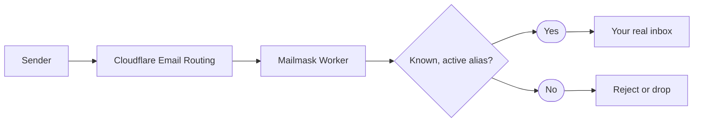

import { Terminology } from '@cbnventures/docusaurus-preset-nova/blocks';

Give every site you sign up for its own address on your domain, and forward the mail to your real inbox without handing that inbox to anyone.

## What Is This?

**Mailmask** turns a domain you already have on Cloudflare into a private alias service. Each <Terminology title="address on your domain that forwards mail" to="/docs/reference/terminology#alias">alias</Terminology> forwards to a real inbox you control, called a <Terminology title="verified real inbox that aliases forward to" to="/docs/reference/terminology#destination">destination</Terminology>.

The forwarding runs on a Cloudflare <Terminology title="Cloudflare Worker that routes your mail" to="/docs/reference/terminology#worker">Worker</Terminology> in your own account, and mail is never stored. You manage everything through an interactive CLI that also deploys the <Terminology title="Cloudflare Worker that routes your mail" to="/docs/reference/terminology#worker">Worker</Terminology> for you.

## Why Use Mailmask?

1. Gives every sign-up a unique address so a leaked or sold address points straight back to the site that leaked it.
2. Lets an <Terminology title="address on your domain that forwards mail" to="/docs/reference/terminology#alias">alias</Terminology> expire on its own so a free trial or one-time download can't keep emailing you.
3. Accepts mail only from the senders you expect so an address that ends up on a spam list stays quiet.
4. Switches an <Terminology title="address on your domain that forwards mail" to="/docs/reference/terminology#alias">alias</Terminology> off in seconds so you can cut off a noisy sender without changing your real address.
5. Runs on your own Cloudflare account so no third-party alias provider sits in the middle of your mail.

## Key Capabilities

- **Unlimited aliases** — Generate memorable (`velvet-harbor-42`) or random (`k7mq2xv9pa`) addresses, or pick your own.
- **Expiring aliases** — Give an <Terminology title="address on your domain that forwards mail" to="/docs/reference/terminology#alias">alias</Terminology> a lifetime like `30m`, `7d`, or a date, and it stops accepting mail on its own.
- **Sender rules** — Allow only specific senders or domains per <Terminology title="address on your domain that forwards mail" to="/docs/reference/terminology#alias">alias</Terminology>, and block the ones that abuse it.
- **One-switch shutdown** — Disable an <Terminology title="address on your domain that forwards mail" to="/docs/reference/terminology#alias">alias</Terminology> without deleting it, so the address stays reserved.
- **Subaddressing** — `alias+anything@` reaches the same <Terminology title="address on your domain that forwards mail" to="/docs/reference/terminology#alias">alias</Terminology>.
- **Refusal notifications** — Get an ntfy notification when a disabled, expired, or filtered <Terminology title="address on your domain that forwards mail" to="/docs/reference/terminology#alias">alias</Terminology> turns mail away.
- **Automatic Email Routing setup** — Deploying registers your inboxes and points the <Terminology title="Email Routing rule for addresses without their own rule" to="/docs/reference/terminology#catch-all">catch-all</Terminology> at the <Terminology title="Cloudflare Worker that routes your mail" to="/docs/reference/terminology#worker">Worker</Terminology>.

## How It Works

When someone emails `velvet-harbor-42@mail.example.com`, Cloudflare hands the message to your <Terminology title="Cloudflare Worker that routes your mail" to="/docs/reference/terminology#worker">Worker</Terminology>. The <Terminology title="Cloudflare Worker that routes your mail" to="/docs/reference/terminology#worker">Worker</Terminology> looks up the <Terminology title="address on your domain that forwards mail" to="/docs/reference/terminology#alias">alias</Terminology>, checks that it is enabled, not expired, and that the sender is allowed, then forwards the message to its <Terminology title="verified real inbox that aliases forward to" to="/docs/reference/terminology#destination">destination</Terminology>.

Mail that doesn't pass those checks is turned away instead of reaching your inbox. Nothing is written to disk along the way.

:::info
Mailmask is forward-only. You receive mail at an <Terminology title="address on your domain that forwards mail" to="/docs/reference/terminology#alias">alias</Terminology>, but replies you send come from your real address, so it is recommended to reply only when you're comfortable revealing it.
:::

## What You Will Need

- **Node.js** — v22 or v24.
- **Cloudflare account** — The free plan is enough.
- **A domain on Cloudflare** — With <Terminology title="Cloudflare service that receives mail for your domain" to="/docs/reference/terminology#cloudflare-email-routing">Cloudflare Email Routing</Terminology> enabled, which adds the mail records for you.
- **A real inbox** — Any address you can read, such as Gmail or Fastmail, to receive forwarded mail.

## Next Steps

- **[Quick Start](/docs/getting-started/quick-start/)** — Install the CLI, create your first <Terminology title="address on your domain that forwards mail" to="/docs/reference/terminology#alias">alias</Terminology>, and deploy.
- **[Configuration](/docs/getting-started/configuration/)** — Every field in `config.json` explained.
- **[Aliases and Expiry](/docs/features/aliases/)** — Create, retire, and time-limit addresses.
- **[Deployment](/docs/getting-started/deployment/)** — Cloudflare token permissions and what deploy changes in your account.
