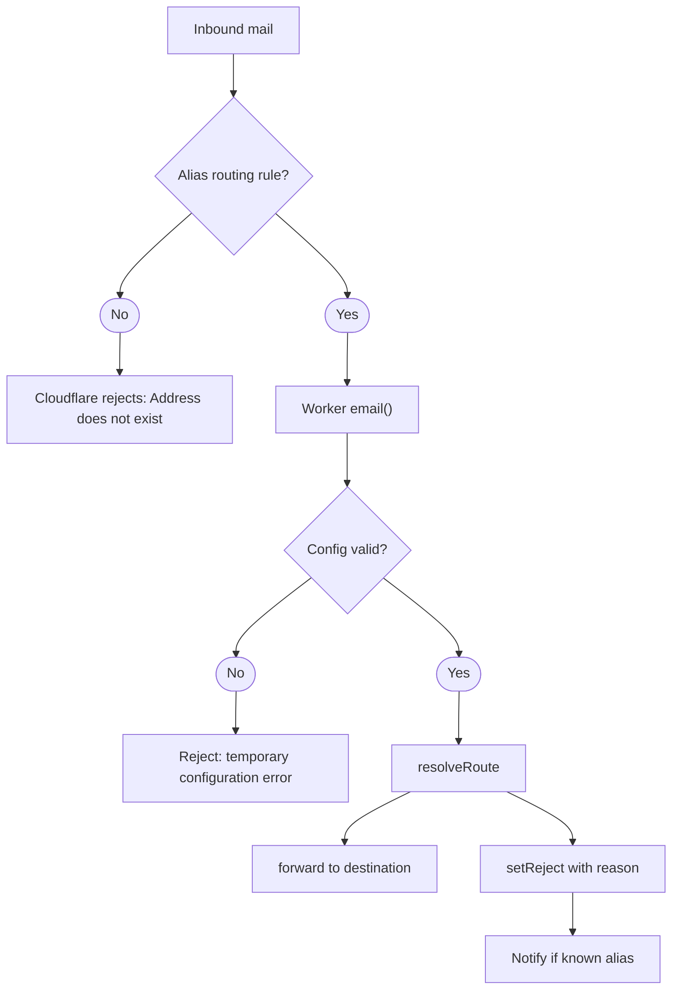

import { Terminology } from '@cbnventures/docusaurus-preset-nova/blocks';

Trace how a message moves through the <Terminology title="Mailmask itself, running on your Cloudflare account" to="/docs/reference/terminology#cloudflare-and-deploy">Worker</Terminology>, how routing decisions are made, and how the CLI turns `config.json` into a running deployment.

## Overview

Mailmask has two parts that run on different runtimes:

- **Cloudflare Worker** (`src/worker/`) — Receives inbound mail from <Terminology title="Cloudflare's mail intake that hands messages to Mailmask" to="/docs/reference/terminology#cloudflare-and-deploy">Cloudflare Email Routing</Terminology> and forwards or rejects it.
- **Node.js CLI** (`src/cli/`) — Edits `config.json`, generates `wrangler.toml`, and deploys.

The CLI writes the <Terminology title="The one file that holds every alias and setting" to="/docs/reference/terminology#cloudflare-and-deploy">config</Terminology>, and deploy bundles it into the <Terminology title="Mailmask itself, running on your Cloudflare account" to="/docs/reference/terminology#cloudflare-and-deploy">Worker</Terminology>. `generate` writes `wrangler.toml` next to your `config.json` and the config to `.wrangler/mailmask/config.json` beside it, along with a small entry file that hands it to the Worker, and Wrangler packs both into one upload. There is no database or storage binding.

Shipping the config inside the <Terminology title="Mailmask itself, running on your Cloudflare account" to="/docs/reference/terminology#cloudflare-and-deploy">Worker</Terminology> avoids environment variables, which Cloudflare caps at 5 KB each, so the config itself has no small fixed limit and can hold many disabled or reserved <Terminology title="A stand-in address; mail still lands in your real inbox" to="/docs/reference/terminology#aliases-and-mail-flow">aliases</Terminology>. Each enabled alias also needs its own Email Routing rule, and deploy stops before the base domain passes Cloudflare's 200-rule limit, counting rules it didn't create.

In an informal test on a laptop, a config with about 50,000 aliases built a Worker of roughly 7 MiB, well under the 64 MiB size limit, and checked its config in a fraction of a second, under the one-second startup limit. That covers the Worker only; the routing rule limit still caps how many aliases can be enabled at once.

## Mail Flow



1. **Receive** — Each enabled alias's <Terminology title="Sends one alias's mail to Mailmask" to="/docs/reference/terminology#cloudflare-and-deploy">routing rule</Terminology> hands its mail to the <Terminology title="Mailmask itself, running on your Cloudflare account" to="/docs/reference/terminology#cloudflare-and-deploy">Worker</Terminology>. Cloudflare rejects addresses without a rule itself.
2. **Validate** — `createWorker` in `src/worker/index.ts` checks the bundled config with the same Zod schema the CLI uses, once when the Worker starts rather than on every message. Invalid config rejects the message instead of silently accepting it.
3. **Resolve** — `resolveRoute` in `src/worker/router.ts` returns a decision: forward or reject, with a reason.
4. **Act** — `handleEmail` in `src/worker/handlers.ts` forwards with alias headers, or refuses and sends a best-effort notification for known aliases.

## Routing Decision

`resolveRoute` is a pure function with no I/O, so every rule is unit-tested directly. It checks, in order:

1. **Domain** — A recipient outside the <Terminology title="The domain every alias lives on" to="/docs/reference/terminology#cloudflare-and-deploy">base domain</Terminology> is rejected.
2. **Subaddress** — With <Terminology title="alias+anything@ still reaches alias@" to="/docs/reference/terminology#aliases-and-mail-flow">subaddressing</Terminology> on, a `+tag` suffix is stripped.
3. **Alias lookup** — An address that isn't an <Terminology title="A stand-in address; mail still lands in your real inbox" to="/docs/reference/terminology#aliases-and-mail-flow">alias</Terminology> is rejected with `Address not found`, which only happens for a stale rule or a `+tag` with subaddressing off.
4. **Enabled** — A disabled <Terminology title="A stand-in address; mail still lands in your real inbox" to="/docs/reference/terminology#aliases-and-mail-flow">alias</Terminology> is refused.
5. **Expiry** — An <Terminology title="A stand-in address; mail still lands in your real inbox" to="/docs/reference/terminology#aliases-and-mail-flow">alias</Terminology> whose `expires_at` has passed is refused.
6. **Block list** — A sender matching `blocked_senders` is refused.
7. **Allow list** — When `allowed_senders` is set, a sender matching none of it is refused.
8. **Destination** — A missing <Terminology title="Your real inbox, where an alias's mail ends up" to="/docs/reference/terminology#aliases-and-mail-flow">destination</Terminology> is rejected as misconfigured; otherwise the message is forwarded.

Every <Terminology title="Mail an alias turns away instead of forwarding" to="/docs/reference/terminology#aliases-and-mail-flow">refusal</Terminology> is a `reject`, so the sender gets a bounce with the reason and the message never forwards anywhere else.

## Web Requests

The <Terminology title="Mailmask itself, running on your Cloudflare account" to="/docs/reference/terminology#cloudflare-and-deploy">Worker</Terminology>'s `fetch` handler answers on its <Terminology title="Your Worker's own web addresses" to="/docs/reference/terminology#cloudflare-and-deploy">custom domains</Terminology>. A request to `www.` plus the <Terminology title="The domain every alias lives on" to="/docs/reference/terminology#cloudflare-and-deploy">base domain</Terminology> gets a `301` to the base domain with the same path and query, before any other check.

## Forwarding

The <Terminology title="Mailmask itself, running on your Cloudflare account" to="/docs/reference/terminology#cloudflare-and-deploy">Worker</Terminology> calls `message.forward()` with the destination address. When `add_alias_headers` is on, it adds:

- `X-Mailmask-Alias` — The original recipient, including any `+tag`.
- `X-Mailmask-Label` — The <Terminology title="A stand-in address; mail still lands in your real inbox" to="/docs/reference/terminology#aliases-and-mail-flow">alias</Terminology> label, when one is set.

The message body is never read, stored, or logged.

## Deploy Pipeline

```mermaid
flowchart LR
    Token[Resolve API token] --> Validate[Validate config]
    Validate --> Zone[Find zone and check permissions]
    Zone --> Routing[Check Email Routing for the base domain]
    Routing --> Plan[Plan custom domains and routing rules]
    Plan --> Dest[Register destinations]
    Dest --> Generate[Generate wrangler.toml]
    Generate --> Publish[wrangler deploy]
    Publish --> Domains[Attach custom domains]
    Domains --> Subaddress[Turn on subaddressing]
    Subaddress --> Rules[Sync alias routing rules]
    Rules --> CatchAll[Hand back a 1.0.0 catch-all]
```



`src/cli/commands/deploy.ts` drives each step through the Cloudflare v4 API, and `src/cli/commands/generate.ts` writes `wrangler.toml` with `workers_dev` and `preview_urls` turned off, plus the Worker entry and config in `.wrangler/mailmask/`. Deploy never enables Email Routing or adds its mail records itself; the only DNS it touches comes from attaching the Worker's custom domains.

Custom domain and routing rule changes are planned before anything on Cloudflare changes, so a conflict such as a host owned by another Worker or the 200-rule limit stops deploy with nothing changed. Routing rules deploy creates carry `mailmask:` plus the Worker name in their name, which keeps several Mailmask Workers on one zone from touching each other's rules.

## Error Strategy

| Layer             | Strategy                                                                        |
|-------------------|---------------------------------------------------------------------------------|
| Worker entry      | Config that fails schema validation rejects the message with a temporary error. |
| Router            | Pure function that always returns a decision and never throws.                  |
| Notifications     | Best effort. Network failures are swallowed.                                    |
| CLI               | Errors are caught per command and set a non-zero exit code.                     |
| Config validation | Zod schemas plus checks for missing destinations and duplicates.                |

## Source Structure

```text
packages/mailmask/src/
├── cli/
│   ├── commands/   — Alias, destination, notifier, settings, config I/O, validate, generate, and deploy
│   ├── menu/       — Interactive configuration interface
│   └── index.ts    — Commander entry point (mailmask / mm)
├── lib/            — Constants, regexes, package paths, and Zod schemas
├── worker/
│   ├── handlers.ts — Forward or reject one message
│   ├── index.ts    — createWorker factory (email and fetch) used by the generated entry
│   ├── notify.ts   — Best-effort refusal notifications
│   └── router.ts   — Pure alias resolution and sender matching
├── tests/          — Unit tests mirroring the source
└── types/          — Type declarations mirroring the source
```
