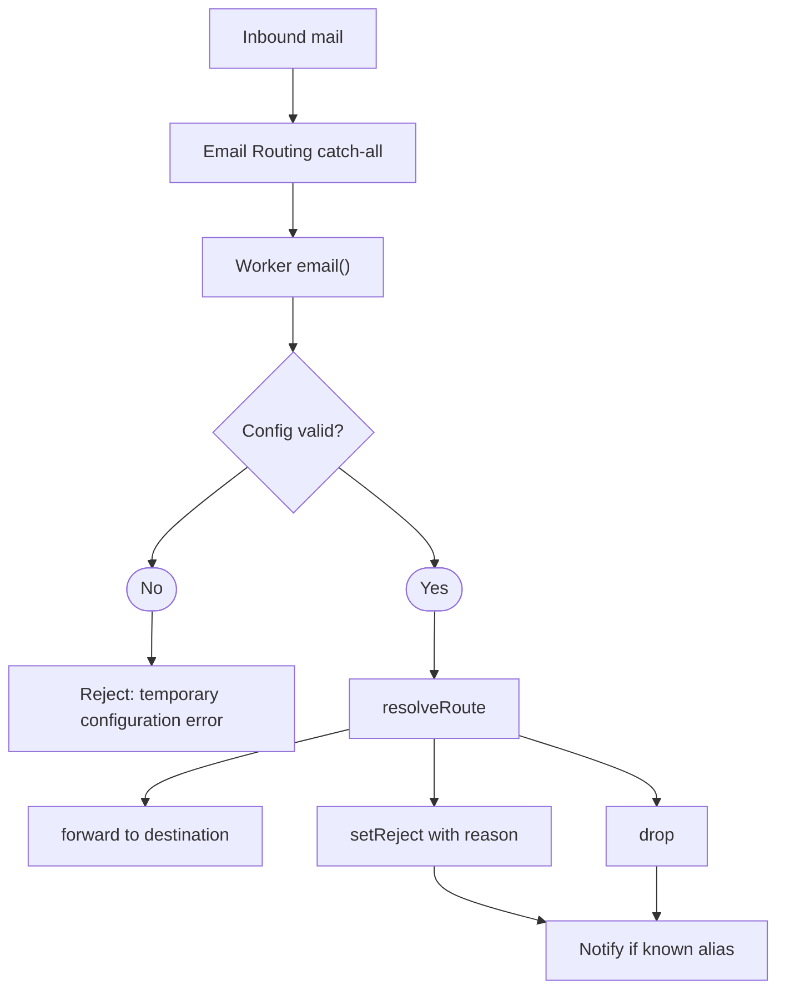
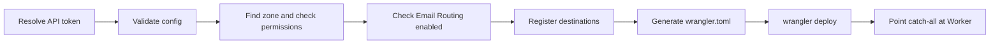

import { Terminology } from '@cbnventures/docusaurus-preset-nova/blocks';

Trace how a message moves through the <Terminology title="Cloudflare Worker that routes your mail" to="/docs/reference/terminology#worker">Worker</Terminology>, how routing decisions are made, and how the CLI turns `config.json` into a running deployment.

## Overview

Mailmask has two parts that run on different runtimes:

- **Cloudflare Worker** (`src/worker/`) — Receives inbound mail from <Terminology title="Cloudflare service that receives mail for your domain" to="/docs/reference/terminology#cloudflare-email-routing">Cloudflare Email Routing</Terminology> and forwards, rejects, or drops it.
- **Node.js CLI** (`src/cli/`) — Edits `config.json`, generates `wrangler.toml`, and deploys.

The CLI writes the <Terminology title="config.json file with destinations, aliases, and settings" to="/docs/reference/terminology#config">config</Terminology>, and deploy injects it into the <Terminology title="Cloudflare Worker that routes your mail" to="/docs/reference/terminology#worker">Worker</Terminology> as three JSON environment variables: `SETTINGS`, `DESTINATIONS`, and `ALIASES`. There is no database or storage binding.

## Mail Flow



1. **Receive** — The <Terminology title="Email Routing rule for addresses without their own rule" to="/docs/reference/terminology#catch-all">catch-all</Terminology> hands every address without its own rule to the <Terminology title="Cloudflare Worker that routes your mail" to="/docs/reference/terminology#worker">Worker</Terminology>.
2. **Validate** — `src/worker/index.ts` parses the three variables and checks them with the same Zod schema the CLI uses. Invalid or unparsable config rejects the message instead of silently accepting it.
3. **Resolve** — `resolveRoute` in `src/worker/router.ts` returns a decision: forward, reject, or drop, with a reason.
4. **Act** — `handleEmail` in `src/worker/handlers.ts` forwards with alias headers, or refuses and sends a best-effort notification for known aliases.

## Routing Decision

`resolveRoute` is a pure function with no I/O, so every rule is unit-tested directly. It checks, in order:

1. **Domain** — A recipient outside the <Terminology title="domain whose catch-all points at the Worker" to="/docs/reference/terminology#base-domain">base domain</Terminology> is rejected.
2. **Subaddress** — With <Terminology title="treating alias+tag@ as alias@" to="/docs/reference/terminology#subaddressing">subaddressing</Terminology> on, a `+tag` suffix is stripped.
3. **Alias lookup** — An unknown address follows the <Terminology title="what happens to mail for non-alias addresses" to="/docs/reference/terminology#unknown-alias-action">unknown alias action</Terminology>.
4. **Enabled** — A disabled <Terminology title="address on your domain that forwards mail" to="/docs/reference/terminology#alias">alias</Terminology> is refused.
5. **Expiry** — An <Terminology title="address on your domain that forwards mail" to="/docs/reference/terminology#alias">alias</Terminology> whose `expires_at` has passed is refused.
6. **Block list** — A sender matching `blocked_senders` is refused.
7. **Allow list** — When `allowed_senders` is set, a sender matching none of it is refused.
8. **Destination** — A missing <Terminology title="verified real inbox that aliases forward to" to="/docs/reference/terminology#destination">destination</Terminology> is rejected as misconfigured; otherwise the message is forwarded.

A <Terminology title="mail a known alias turns away" to="/docs/reference/terminology#refusal">refusal</Terminology> uses `drop` when the unknown alias action is `drop`, and `reject` otherwise. Refusals never fall through to the default <Terminology title="verified real inbox that aliases forward to" to="/docs/reference/terminology#destination">destination</Terminology>.

## Forwarding

The <Terminology title="Cloudflare Worker that routes your mail" to="/docs/reference/terminology#worker">Worker</Terminology> calls `message.forward()` with the destination address. When `add_alias_headers` is on, it adds:

- `X-Mailmask-Alias` — The original recipient, including any `+tag`.
- `X-Mailmask-Label` — The <Terminology title="address on your domain that forwards mail" to="/docs/reference/terminology#alias">alias</Terminology> label, when one is set.

The message body is never read, stored, or logged.

## Deploy Pipeline



`src/cli/commands/deploy.ts` drives each step through the Cloudflare v4 API, and `src/cli/commands/generate.ts` writes `wrangler.toml` with `workers_dev` and `preview_urls` turned off. Deploy never enables Email Routing or edits DNS.

## Error Strategy

| Layer             | Strategy                                                                                   |
|-------------------|--------------------------------------------------------------------------------------------|
| Worker entry      | Invalid or unparsable config rejects the message with a temporary error.                   |
| Router            | Pure function that always returns a decision and never throws.                             |
| Notifications     | Best effort. Network failures are swallowed.                                               |
| CLI               | Errors are caught per command and set a non-zero exit code.                                |
| Config validation | Zod schemas plus checks for missing destinations, duplicates, and the default destination. |

## Source Structure

```text
packages/mailmask/src/
├── cli/
│   ├── commands/   — Alias, destination, settings, validate, generate, and deploy
│   ├── menu/       — Interactive configuration interface
│   └── index.ts    — Commander entry point (mailmask / mm)
├── lib/            — Constants, regexes, package paths, and Zod schemas
├── worker/
│   ├── handlers.ts — Forward, reject, or drop one message
│   ├── index.ts    — Worker entry point (email and fetch)
│   ├── notify.ts   — Best-effort refusal notifications
│   └── router.ts   — Pure alias resolution and sender matching
├── tests/          — Unit tests mirroring the source
└── types/          — Type declarations mirroring the source
```
