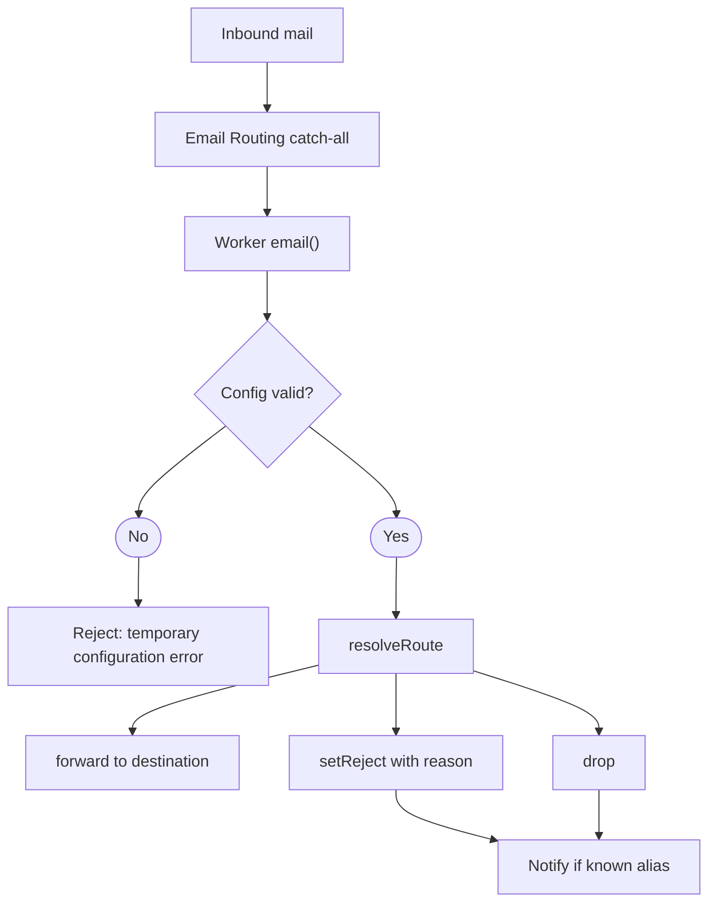
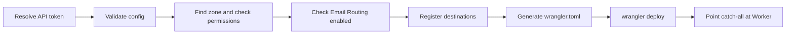

import { Terminology } from '@cbnventures/docusaurus-preset-nova/blocks';

Trace how a message moves through the <Terminology title="Mailmask itself, running on your Cloudflare account" to="/docs/reference/terminology#cloudflare-and-deploy">Worker</Terminology>, how routing decisions are made, and how the CLI turns `config.json` into a running deployment.

## Overview

Mailmask has two parts that run on different runtimes:

- **Cloudflare Worker** (`src/worker/`) — Receives inbound mail from <Terminology title="Cloudflare's mail intake that hands messages to Mailmask" to="/docs/reference/terminology#cloudflare-and-deploy">Cloudflare Email Routing</Terminology> and forwards, rejects, or drops it.
- **Node.js CLI** (`src/cli/`) — Edits `config.json`, generates `wrangler.toml`, and deploys.

The CLI writes the <Terminology title="The one file that holds every alias and setting" to="/docs/reference/terminology#cloudflare-and-deploy">config</Terminology>, and deploy bundles it into the <Terminology title="Mailmask itself, running on your Cloudflare account" to="/docs/reference/terminology#cloudflare-and-deploy">Worker</Terminology>. `generate` writes `wrangler.toml` next to your `config.json` and the config to `.wrangler/mailmask/config.json` beside it, along with a small entry file that hands it to the Worker, and Wrangler packs both into one upload. There is no database or storage binding.

Shipping the config inside the <Terminology title="Mailmask itself, running on your Cloudflare account" to="/docs/reference/terminology#cloudflare-and-deploy">Worker</Terminology> avoids environment variables, which Cloudflare caps at 5 KB each, so the <Terminology title="A stand-in address; mail still lands in your real inbox" to="/docs/reference/terminology#aliases-and-mail-flow">alias</Terminology> list has no small fixed limit. Instead, it is bounded by Cloudflare's Worker size and startup time limits.

In an informal test on a laptop, a config with about 50,000 aliases built a Worker of roughly 7 MiB, well under the 64 MiB size limit, and checked its config in a fraction of a second, under the one-second startup limit. Cloudflare's limits can change, so it is recommended to check the current [Workers limits](https://developers.cloudflare.com/workers/platform/limits/) before relying on a very large alias list.

## Mail Flow



1. **Receive** — The <Terminology title="Sends every address to Mailmask, so new aliases just work" to="/docs/reference/terminology#cloudflare-and-deploy">catch-all</Terminology> hands every address without its own rule to the <Terminology title="Mailmask itself, running on your Cloudflare account" to="/docs/reference/terminology#cloudflare-and-deploy">Worker</Terminology>.
2. **Validate** — `createWorker` in `src/worker/index.ts` checks the bundled config with the same Zod schema the CLI uses, once when the Worker starts rather than on every message. Invalid config rejects the message instead of silently accepting it.
3. **Resolve** — `resolveRoute` in `src/worker/router.ts` returns a decision: forward, reject, or drop, with a reason.
4. **Act** — `handleEmail` in `src/worker/handlers.ts` forwards with alias headers, or refuses and sends a best-effort notification for known aliases.

## Routing Decision

`resolveRoute` is a pure function with no I/O, so every rule is unit-tested directly. It checks, in order:

1. **Domain** — A recipient outside the <Terminology title="The domain every alias lives on" to="/docs/reference/terminology#cloudflare-and-deploy">base domain</Terminology> is rejected.
2. **Subaddress** — With <Terminology title="alias+anything@ still reaches alias@" to="/docs/reference/terminology#aliases-and-mail-flow">subaddressing</Terminology> on, a `+tag` suffix is stripped.
3. **Alias lookup** — An unknown address follows the <Terminology title="What happens to mail for an address you never made" to="/docs/reference/terminology#aliases-and-mail-flow">unknown alias action</Terminology>.
4. **Enabled** — A disabled <Terminology title="A stand-in address; mail still lands in your real inbox" to="/docs/reference/terminology#aliases-and-mail-flow">alias</Terminology> is refused.
5. **Expiry** — An <Terminology title="A stand-in address; mail still lands in your real inbox" to="/docs/reference/terminology#aliases-and-mail-flow">alias</Terminology> whose `expires_at` has passed is refused.
6. **Block list** — A sender matching `blocked_senders` is refused.
7. **Allow list** — When `allowed_senders` is set, a sender matching none of it is refused.
8. **Destination** — A missing <Terminology title="Your real inbox, where an alias's mail ends up" to="/docs/reference/terminology#aliases-and-mail-flow">destination</Terminology> is rejected as misconfigured; otherwise the message is forwarded.

A <Terminology title="Mail an alias turns away instead of forwarding" to="/docs/reference/terminology#aliases-and-mail-flow">refusal</Terminology> uses `drop` when the unknown alias action is `drop`, and `reject` otherwise. Refusals never fall through to the default <Terminology title="Your real inbox, where an alias's mail ends up" to="/docs/reference/terminology#aliases-and-mail-flow">destination</Terminology>.

## Forwarding

The <Terminology title="Mailmask itself, running on your Cloudflare account" to="/docs/reference/terminology#cloudflare-and-deploy">Worker</Terminology> calls `message.forward()` with the destination address. When `add_alias_headers` is on, it adds:

- `X-Mailmask-Alias` — The original recipient, including any `+tag`.
- `X-Mailmask-Label` — The <Terminology title="A stand-in address; mail still lands in your real inbox" to="/docs/reference/terminology#aliases-and-mail-flow">alias</Terminology> label, when one is set.

The message body is never read, stored, or logged.

## Deploy Pipeline



`src/cli/commands/deploy.ts` drives each step through the Cloudflare v4 API, and `src/cli/commands/generate.ts` writes `wrangler.toml` with `workers_dev` and `preview_urls` turned off, plus the Worker entry and config in `.wrangler/mailmask/`. Deploy never enables Email Routing or edits DNS.

## Error Strategy

| Layer             | Strategy                                                                                   |
|-------------------|--------------------------------------------------------------------------------------------|
| Worker entry      | Config that fails schema validation rejects the message with a temporary error.            |
| Router            | Pure function that always returns a decision and never throws.                             |
| Notifications     | Best effort. Network failures are swallowed.                                               |
| CLI               | Errors are caught per command and set a non-zero exit code.                                |
| Config validation | Zod schemas plus checks for missing destinations, duplicates, and the default destination. |

## Source Structure

```text
packages/mailmask/src/
├── cli/
│   ├── commands/   — Alias, destination, notifier, settings, config I/O, validate, generate, and deploy
│   ├── menu/       — Interactive configuration interface
│   └── index.ts    — Commander entry point (mailmask / mm)
├── lib/            — Constants, regexes, package paths, and Zod schemas
├── worker/
│   ├── handlers.ts — Forward, reject, or drop one message
│   ├── index.ts    — createWorker factory (email and fetch) used by the generated entry
│   ├── notify.ts   — Best-effort refusal notifications
│   └── router.ts   — Pure alias resolution and sender matching
├── tests/          — Unit tests mirroring the source
└── types/          — Type declarations mirroring the source
```
